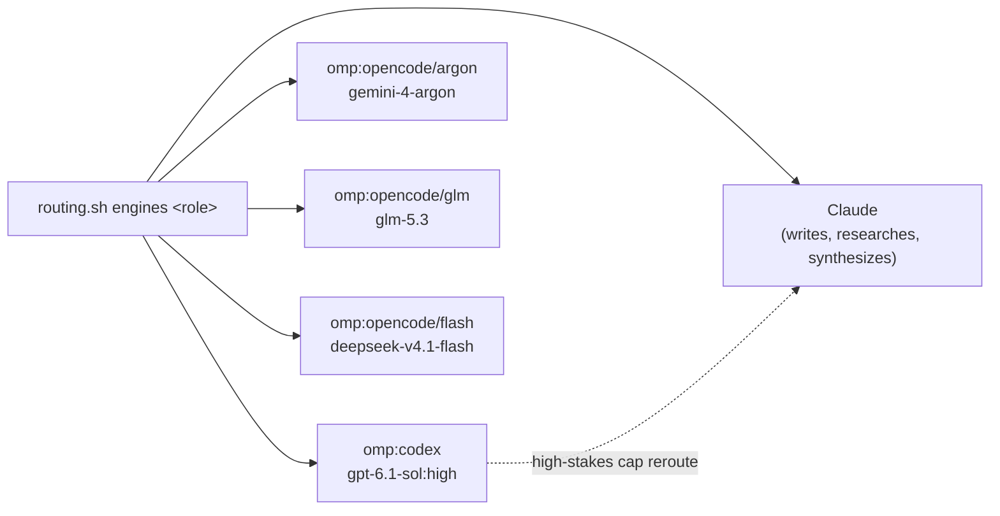
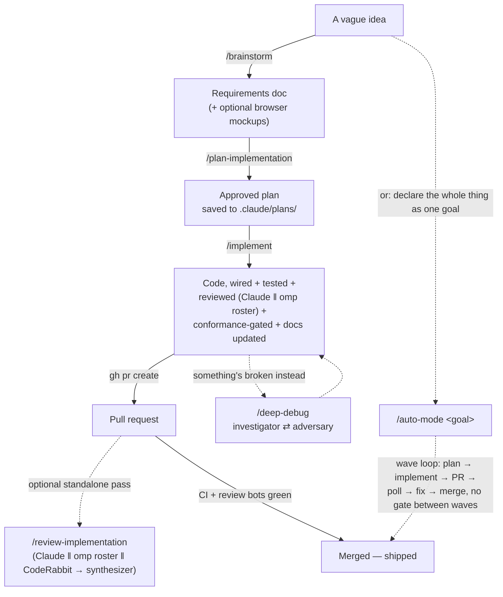

# Agent Suite

A reusable Claude Code agent suite — dispatched agents across 8 workflows — frontier roles ride `model: inherit`
(whatever the session's top model is), mechanical/summarization roles carry an explicit pin (see Maintenance).
Organized by **what you're doing** (workflow), not by technical domain. Drop this
`.claude/agents/` directory into any project; run `/bootstrap-project` (see the Bootstrap
workflow below) once to adapt the templated files to that project's actual stack.

**Engine strategy:** Claude is the only writer. The other engines are read-only omp engines, `omp:codex`
(`openai-codex/gpt-6.1-sol`, high) and `omp:opencode` (the Go slots `argon`, `glm`, `flash`), run through
`scripts/omp-engine.sh`. Who joins a step is data in `routing.json`: ask `bash .claude/scripts/routing.sh
engines <role>` for the roster, never hard-code an engine. omp output is untrusted analysis text: Claude
verifies findings against the source, counts only completed valid passes and distinct engines, discloses
degradation, and never counts `omp:codex` twice. A capped slot falls back to its own fallback model; a capped
high-stakes slot (review, architect, security) reroutes to `omp:codex`, or degrades honestly if it is already
in the run. Native Codex is an opt-in pack (`install.sh --pack codex`), never an automatic fallback.



| Role (`routing.sh engines`) | Stakes | Engines |
| --- | --- | --- |
| `review` (lean gate, full review) | high | Claude, `omp:codex`, `omp:opencode/argon` |
| `planning` (second planner, plan critique) | normal | Claude, `omp:codex`, `omp:opencode/argon` |
| `architect` (architect pair, `/second-opinion`, advisor gate) | high | Claude, `omp:codex` |
| `debug` (`/deep-debug` investigator pair) | normal | Claude, `omp:opencode/glm` |
| `security` (`/security-audit`) | high | Claude, `argon` and `flash` co-equal (flash 2-3 runs); `omp:codex` is the cap reroute |
| `audits` (error, API, tech-debt) | normal | Claude, `omp:opencode/glm` |
| `docs` (docs-vs-code checks) | normal | Claude, `omp:opencode/argon` |
| `explore`, `research` (long reads), `verify` (REPRODUCE/REFUTE lenses) | normal | `omp:opencode/flash` |
| test writing, review-bot triage, strict-JSON drafts | normal | Claude only, until a bake-off decides otherwise |

Argon versus flash as the security lead is decided by a seeded-vulnerability bake-off; until then they run
co-equal. Implementation, the conformance-test writer and the docs-updater (Claude Haiku 5.5, writing the
docs itself) are Claude only. Routing defaults can change; the shipped `routing.json` is authoritative.

- **Model pins.** Frontier roles (orchestrators, planner, architect, judge, the Implementer, reviewers, the
  security agents, the debug investigator and adversary, research) are `model: inherit` and follow the session.
  Explicit pins: `claude-sonnet-5` for the plan explorer, the error-audit scanner, `dependency-audit`,
  `local-ci`, `brainstorm` and `respond-to-review`; `claude-haiku-5-5` for `impl-docs-updater`; `opus` for
  `impl-coder-ui`. Effort follows the file's frontmatter: `xhigh` for the orchestrators, planner/architect/judge,
  both Implementers, the conformance writer, the debug agents and the security IDOR/synthesizer agents; `high`
  for the reviewer, research, the review synthesizer and the scanners; `medium` for the API, docs and
  tech-debt orchestrators; `low` for `local-ci` and `dependency-audit`.

**Core principle:** Specialist agents do the heavy lifting (research, code, review) but never touch git or external systems. The orchestrator (the main session) owns those actions: it commits and pushes as `/implement` and `/auto-mode` describe, and every outward action (opening or merging a PR, ticket updates, releases) follows the user's authorisation for the run.

---

## Directory Structure

```
.claude/agents/
│
├── README.md                        # THIS FILE — index of all agents
│
├── brainstorm.md                    # Creative exploration — vague ideas → requirements docs
│
├── bootstrap/                       # Workflow: Onboard this harness onto a new project
│   └── orchestrator.md              # Explore → research → confirm with user → fill in {{TOKEN}}s → report follow-ups
│
├── research/                        # Standalone research (user-facing, not pipeline)
│   └── agent.md                     # Research agent: `mode: sub-question` (default, /research fan-out) | `mode: plan` (plan pipeline researcher: Libraries / Pitfalls / Recommended patterns). Exa + Context7
├── local-ci.md                      # Full CI pipeline (format, lint, typecheck, build, test)
├── respond-to-review.md             # PR review response — verify claims, draft responses
│
├── implementation/                  # Workflow: Build a feature/fix (4 roles)
│   ├── orchestrator.md              # Pipeline manager: routed Implementer → Review → tail → re-index
│   ├── coder-ui.md                  # Role 1 for design-heavy web UI — Claude UI Implementer, frontend-design skill, browser check vs the design reference (`routing.sh ui`)
│   ├── implementer.md               # Role 1 — the fused Implementer (agent `impl-implementer`), run in Claude (`routing.sh implementation` prints `claude`); also the canonical loop envelope
│   ├── docs-updater.md              # Role 3 (tail) — updates docs after implementation
│   └── conformance-test-writer.md   # Role 3 (tail) — author-blind, plan-derived conformance gate
│
├── plan/                            # Workflow: Explore, research, architect, plan
│   ├── orchestrator.md              # Discovery triage → explore/research → multi-engine architect+judge → multi-engine plan+judge (no single-planner path)
│   ├── explorer.md                  # Deep codebase scan for related code and patterns
│   ├── architect.md                 # One of two parallel architects — synthesizes into 2-3 approaches with trade-offs
│   ├── judge-selector.md            # Select-then-graft: picks the stronger of two architect/planner passes
│   └── planner.md                   # Detailed plan with backward verification + wave splitting
│
├── review/                          # The Claude reviewer shared by both review gates
│   └── claude-reviewer.md           # `depth: lean` (Role 2 gate, one full-category pass) | `depth: full` (+ six-domain appendix, full multi-engine review)
│
├── review-implementation/           # Workflow: Self-review (multi-engine + synthesizer)
│   ├── orchestrator.md              # Branch-aware; Claude ‖ the omp roster (`routing.sh engines review`) ‖ CodeRabbit or equivalent → synthesizer
│   └── synthesizer.md               # The only merge (full and lean): dedup + NEW/MODIFIED/PRE-EXISTING + fix plan + memory decision
│
├── debug/                           # Workflow: Heavy investigation
│   ├── investigator.md              # Claude + the omp debug engine (`routing.sh engines debug`) — root cause analysis, log tracing
│   └── adversary.md                 # Claude — adversarial hypothesis tester (disprove/confirm)
│
├── codebase/                        # Workflow: Full-codebase analysis (occasional)
│   ├── orchestrator.md              # Two-tier dispatcher (quick health check / deep audits)
│   ├── verification.md              # The shared REPRODUCE / REFUTE lens rule for every deep audit
│   ├── dependency-audit.md          # Judges `scripts/dep-audit.sh`: vulnerabilities, outdated deps, licenses
│   ├── security-audit/                       # Periodic deep audit — Claude plus the omp security roster, ASVS 5.0 L2
│   │   ├── orchestrator.md          # cartographer → deep agents → synthesizer; union-recall + evidence-precision
│   │   ├── audit-cartographer.md    # Stage 1 — app-intent map (endpoints/authz, tenant key, domain-critical sites, PII/SSRF)
│   │   ├── access-control-idor.md   # Stage 2 multi-engine — whole-app authz, IDOR, exposure, SSRF (always runs)
│   │   └── audit-synthesizer.md     # Stage 3 — evidence-demanding synthesis, ASVS 5.0, memory write
│   ├── error-audit/
│   │   ├── orchestrator.md          # scanner per scope on Claude and the omp roster, then merge + verify
│   │   └── scanner.md               # `scope=backend` (controllers/routes, services, global infra) | `scope=frontend` (hooks, components, pages, global UI)
│   ├── api-audit/
│   │   └── orchestrator.md          # endpoint-inventory script, then auth and contract passes on Claude + omp
│   ├── docs-audit/
│   │   └── orchestrator.md          # stale-reference script, then API and architecture doc passes on Claude + omp
│   └── tech-debt-audit/
│       └── orchestrator.md          # tech-debt-scan + dep-audit scripts, then a pattern pass on Claude + omp
│
(optional packs add more agent folders, e.g. `copywrite/` and `orchestrator/` -- see `packs/README.md`)
```

---

## Bootstrap workflow (`/bootstrap-project`, run once per new project)

The harness ships with templated files (`{{TOKEN}}` placeholders throughout — see
`bootstrap/orchestrator.md` for the full token list) so it can be dropped into any
project without hand-editing dozens of files. `bootstrap/orchestrator.md` explores the
target repo (via the generic `Explore` agent), researches anything ambiguous (via the
`research-agent` subagent type), confirms a synthesized project profile with the user,
asks the genuine judgment calls a repo can't answer itself (Docker-first? optional
hooks? branching model?), fills in `CLAUDE.md` / `settings.json` / opted-in hooks, and
reports a follow-up punch list (credentials, repo settings, unfilled optional slots).
Run it once when adopting this harness on a new codebase; re-run it if the stack
changes significantly.

## Complete workflow: idea to shipped

The workflows below compose into one lifecycle — this is what actually happens between
"I have an idea" and "it's merged":



The manual path stops for your approval at two hard gates (plan approach, plan review)
and again before every PR merge. `/deep-debug` and the `/codebase-audit` family (below)
plug into this loop wherever something's broken or the whole repo needs a periodic
sweep, rather than sitting on the happy path. Each workflow below has its own `README.md`
with the full per-step diagram — this file is the map of how they fit together.

## Plan workflow (`/plan-implementation`)

Turns a task into an approved, backward-verified plan before any code gets written.
Discovery triage decides how far the researcher looks (standard / deep; the explorer and
researcher always both run), then independent architects (Claude plus the omp architect) propose approaches in parallel and a judge picks
the stronger one — grafting in whatever the loser got right — rather than blending two
drafts into a compromise neither would have written alone. The planner that follows does
the same multi-engine-then-judge pass for the step-by-step plan itself, plus a
goal-backward verification pass that catches missing wiring/error-handling before you ever
approve it. See `agents/plan/README.md` for the full 8-step diagram.

## Implementation workflow (`/implement`)

Builds the approved plan. The Implementer (`routing.sh implementation`, Claude) writes the code, wires it in,
and writes its own tests; a lean internal review gate (a Claude pass ‖ the omp roster, 2-vote
consensus) catches must-fix issues before the tail — an author-blind conformance-test
writer (who only ever saw the plan, never the diff or the Implementer's own tests) and a
docs updater. See `agents/implementation/README.md` for the full pipeline diagram.

## Review workflow (`/review-implementation`)

The heavy, standalone review pass — not the same machine as `/implement`'s internal gate.
Independent engines (Claude, the omp roster, and a third-party review
bot if the project has one) each review the diff blind to the others' findings, then a
synthesizer agent merges them: cross-engine agreement is HIGH confidence, a single critical
finding still survives on its own. Every finding is provenance-labelled NEW / MODIFIED /
PRE-EXISTING against the merge-base, and the output is an ordered fix plan plus a
deliberate memory-write decision — not just a wall of comments. See
`agents/review-implementation/README.md` for the full diagram.

## Debug workflow (`/deep-debug`)

Root-cause investigation with a built-in check on its own conclusions: a multi-engine
investigator (Claude + the omp debug engine) proposes a hypothesis, then a dedicated adversary agent
tries to disprove it — up to 3 cycles — before you act on anything. A quick triage step
runs first so trivial bugs don't pull in the heavy machinery. The optional `queue-agents` pack adds a
background-job/async-pipeline specialist for debug and for `/error-audit`. See `agents/debug/README.md` for the full diagram.

## Codebase audit workflows (`/codebase-audit` and friends)

A two-tier system for whole-repo analysis, not a per-PR gate. Tier 1 (`/codebase-audit`,
~5 min) is a quick health check — dependency issues, dead code, tech-debt signals, API
surface, doc freshness. Tier 2 is five independently-invocable deep audits (security, API
contract, error paths, docs accuracy, tech debt), each run on Claude plus the omp roster where it matters most.
The security audit is the deepest: a cartographer builds a shared app-intent map first
(endpoints/authz, PII/SSRF surface), two stage-2 agents hunt in parallel against that map,
and an evidence-demanding synthesizer refuses to let a finding through without proof,
reporting against ASVS 5.0 L2. See `agents/codebase/README.md` for the full diagram.

## Copywriting suite (optional `copywrite` pack)

`/copywrite` and its six agents (voice, microcopy, localization, consistency, Apple voice rubric and style guide)
ship as `packs/copywrite` (`install.sh --pack copywrite`): they are only useful where the project has user-facing
copy, and the Romanian ICU, Babel and diacritic gates stay inside the pack. See `packs/copywrite/README.md`.

---

## Slash Commands

| Command                  | Workflow                                                                          | What it dispatches                                                                            |
| ------------------------ | ----------------------------------------------------------------------------------- | ----------------------------------------------------------------------------------------------- |
| `/bootstrap-project`      | Onboard this harness onto a new project (run once)                               | `bootstrap/orchestrator.md`                                                                     |
| `/research`              | Standalone research                                                               | `research/agent.md` — Context7 + web search + Playwright, saves report to `.claude/research/` |
| `/brainstorm`            | Creative exploration                                                              | `brainstorm.md`                                                                               |
| `/plan-implementation`   | Plan before coding                                                                | `plan/orchestrator.md`                                                                        |
| `/implement`             | Build features/fixes                                                              | `implementation/orchestrator.md` (includes a lean internal Claude‖omp code-review gate)     |
| `/review-implementation` | Self-review (heavy, standalone); `--lean` is the lean multi-engine gate on the current diff (standalone form of `/implement` Step 13) | `review-implementation/orchestrator.md`; `--lean`: `review/claude-reviewer.md` (`depth: lean`) ‖ `omp-engine.sh review` (roster from `routing.sh engines review`), merged by `review-implementation/synthesizer.md` |
| `/second-opinion`        | Second opinion from the other engine; `--advisor` = read-only adversarial critique | `scripts/omp-engine.sh ask` (`omp:codex`)                                                     |
| `/deep-debug`            | Heavy investigation                                                               | `debug/investigator.md` + `debug/adversary.md` (+ the queue-agents pack's `queue.md` for async-pipeline bugs) |
| `/run-ci`                | CI verification                                                                   | `scripts/run-ci.sh`, diagnosed by `local-ci.md`                                                                                 |
| `/respond-to-review`     | PR response drafting (human reviewers; AI review bots get their own mode)         | `respond-to-review.md`                                                                        |
| `/improve-prompt`        | Prompt optimization                                                               | Uses `prompts/prompt-engineering-claude.md` guide                                                    |
| `/codebase-audit`        | Codebase analysis                                                                 | `codebase/orchestrator.md` (quick or deep mode)                                               |
| `/security-audit`        | Codebase analysis                                                                 | `codebase/security-audit/orchestrator.md` — OWASP ASVS L2                                     |
| `/error-audit`           | Codebase analysis                                                                 | `codebase/error-audit/orchestrator.md` — error path audit                                     |
| `/api-audit`             | Codebase analysis                                                                 | `codebase/api-audit/orchestrator.md` — API contract audit                                     |
| `/docs-audit`            | Codebase analysis                                                                 | `codebase/docs-audit/orchestrator.md` — documentation accuracy                                |
| `/tech-debt-audit`       | Codebase analysis                                                                 | `codebase/tech-debt-audit/orchestrator.md` — tech debt audit                                  |

---

## Key Features

**Bootstrap (one-time per project):**

- Explore-then-research-then-ask discipline — never guesses a stack fact the repo can
  answer directly, never silently defaults a policy question a human should decide
- Confirms the synthesized project profile before writing any file
- Fills in `{{TOKEN}}` placeholders in `CLAUDE.md` / `settings.json` / opted-in hooks
  only — the rest of the agent suite resolves tokens per-invocation from the project's
  own `CLAUDE.md`, so it never drifts out of sync when the stack changes
- Reports a follow-up punch list instead of silently leaving gaps

**Implementation pipeline:**

- Session resume via `<task>` XML blocks in plan files — crash at Step 8, resume from Step 8
- Analysis paralysis guard on writing agents (7-read threshold)
- Deviation rules for coder (auto-fix trivial, STOP on architectural surprises)
- Self-check step verifies every plan step was actually implemented
- Lean multi-engine code-review gate (Step 13): a Claude pass and the omp roster in parallel, 2-vote consensus + ≤2 rework cycles — separate from and much leaner than the standalone `/review-implementation`
- Plan splitting into waves for 12+ step plans (fresh context per wave)
- Optional project-specific domain-rubric gate slot (Role 3, conditional) — wire up your own isolated-context grader for any non-numeric, structural/textual artifact class this project cares about (see `implementation/orchestrator.md`'s Role 3 note)

**Planning pipeline:**

- Discovery triage: standard (explorer ‖ researcher) / deep (expanded research)
- Multi-engine architect (Claude ‖ the omp architect) + judge-selector (select-then-graft, never blend), anonymised by `scripts/blind-candidates.sh`
- Multi-engine planner + judge-selector on every task (no minimal depth, no single-planner shortcut)
- Goal-backward verification catches missing wiring and error handling
- Dual-format plans (MD + XML) for machine-parseable status tracking

**Debug pipeline:**

- Adversarial verification loop: investigator proposes hypothesis, adversary tries to disprove it (max 3 cycles)
- Multi-engine investigation (Claude agent + the read-only omp debug engine via `omp-engine.sh`) with cross-reference merge
- Quick triage step before heavy agent dispatch
- Optional `queue-agents` pack: background-job/async-pipeline specialists for debug and error-audit — adapt to whatever queue/broker system this project actually uses

**Review pipelines:**

- Multi-engine review: Claude comprehensive reviewer ‖ the omp roster (`routing.sh engines review`; an engine that is skipped or capped is named with its reason) ‖ a third-party PR bot if this project has one, each blind to the others (recall)
- Synthesizer (a further Claude agent): dedupes across engines, cross-engine agreement = HIGH confidence (an omp-only finding is verified against the source first), critical survives a single engine (precision)
- Branch-aware: detects base, reviews authored working-tree changes (incl. uncommitted)
- Provenance labelling: each finding tagged NEW / MODIFIED / PRE-EXISTING vs the merge-base
- Produces an ordered fix plan for the Implementer + a deliberate memory-write decision
- No engine re-checks lint/type/style — the deterministic gate owns that
- Fill in `review/claude-reviewer.md`'s Project Conventions block with this project's actual conventions before relying on either gate

**Codebase audit two-tier system:**

- Tier 1 quick health check (~5 min): four scripts (`dep-audit.sh`, `tech-debt-scan.sh`, `endpoint-inventory.sh`, `stale-reference-scan.sh`) cover dependency issues, tech debt signals, API surface and doc freshness
- Tier 2 deep audits: 5 standalone multi-agent audits (security, error, API, docs, tech debt) with multi-engine consensus, REPRODUCE/REFUTE verification, semi-formal reasoning, mid-thought abort, and conventions-first anchoring
- Security audit (periodic; Claude plus the omp security roster): cartographer → access-control/IDOR ‖ domain-integrity (optional; skipped unless the project configures it from `templates/security-domain-integrity.md`) → evidence-demanding synthesizer; ASVS 5.0 L2 as the reporting taxonomy, not the decomposition
- Each tier 2 audit is independently invocable via its own slash command

---

## Output Contract

All review agents produce findings in this format:

```markdown
#### [CRITICAL|HIGH|MEDIUM|LOW]-001: [title]

- **Severity**: CRITICAL | HIGH | MEDIUM | LOW
- **File**: `path/to/file.ts:L42-L58`
- **Issue**: [description]
- **Impact**: [what happens if unfixed]
- **Fix**: [specific approach]
- **Confidence**: HIGH | MEDIUM | LOW
```

---

## Maintenance

- Model rides the session via `model: inherit` for every frontier role; the explicit pins are listed in the Engine strategy section at the top. Don't pin a frontier agent to a specific model — inherit is what lets the suite follow the session. Engine choices live in `routing.json`, not in the agent files.
- Agents read this project's own `CLAUDE.md` dynamically — conventions live there, not hardcoded into the agent files.
- Several files ship as explicit templates (`{{TOKEN}}` placeholders, `.template` suffixes, or a "STUB — fill this in" header): `bootstrap/orchestrator.md`'s target is `CLAUDE.md`/`settings.json`; `templates/security-domain-integrity.md` (the security orchestrator skips that lens until a configured copy exists); the copywrite pack's brand-terms and register-memo templates. Fill these in per-project before relying on the agents that read them.
- Stack-specific checklists (`review/claude-reviewer.md`'s Project Conventions block, the error-audit agents' `<context>`/`<conventions>` blocks) ship as placeholder shapes — fill them in with this project's real conventions; project-specific invariants belong in this project's own `.claude/rules/` files, referenced from these agents, not hand-copied into every agent.
- Each agent is standalone — orchestrators are convenience, any specialist can be invoked directly
