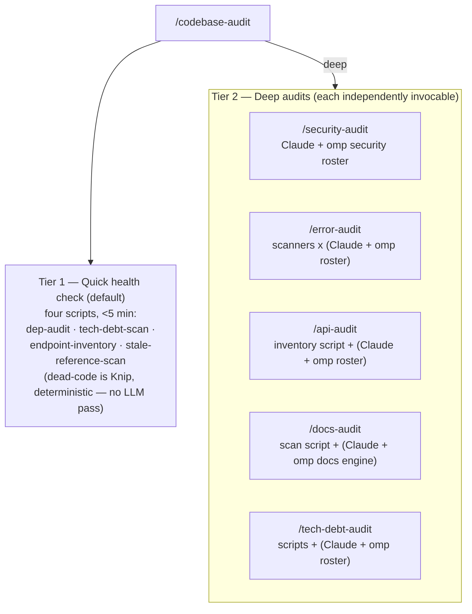
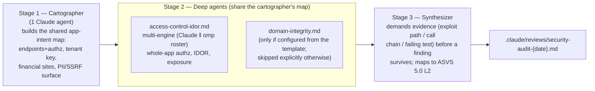

# Codebase Analysis Agents

Two-tier audit architecture for full-codebase analysis. These scan the **entire codebase**, not just diffs or individual PRs.



**Zoom: `/security-audit`'s internal shape** (the deepest of the five — cartographer →
focused deep agents → evidence-demanding synthesizer, not just N parallel scanners):



Why this shape and not 5 identical scanning passes: LLM security scans plateau at 2-3
passes (more adds false positives, not findings) and hit >50% false-positive rates
without evidence-demanding synthesis — see `security-audit/orchestrator.md`'s "Why this
shape" section for the full reasoning.

## Tier 1: Quick Health Check

Dispatched by `/codebase-audit` (default mode). Finishes in under 5 minutes.

| Check | Run by | What it scans |
|-------|--------|---------------|
| Dependency Audit | `scripts/dep-audit.sh` (+ `dependency-audit.md` to judge it) | npm vulnerabilities, outdated packages, licenses, Node.js CVEs |
| Tech Debt (light) | `scripts/tech-debt-scan.sh` | TODO/FIXME counts, `as any`, large files, empty catches |
| API Surface (light) | `scripts/endpoint-inventory.sh` | Endpoint count, public endpoints, controller count |
| Docs Freshness (light) | `scripts/stale-reference-scan.sh` | Doc references to files, env vars, scripts and commands that no longer exist |

_Dead-code detection moved to the quality gate (Knip, deterministic) — no LLM pass. A script that reports
`unsupported` (another stack) is listed as not covered, never guessed._

## Tier 2: Deep Audits

Each is a standalone multi-agent audit with its own orchestrator. Dispatched individually or all at once via `/codebase-audit deep`.

| Audit | Command | Directory | Passes | Engines |
|-------|---------|-----------|--------|---------|
| Security | `/security-audit` | `security-audit/` | cartographer → IDOR/domain-integrity → synthesizer | Claude plus `routing.sh engines security` (argon and flash co-equal, flash 2-3 runs); union + evidence-synth |
| Error Paths | `/error-audit` | `error-audit/` | one `scanner.md` per scope (backend, frontend, optional queue) | Claude plus `routing.sh engines audits`, same scanner text |
| API Contract | `/api-audit` | `api-audit/` | inventory script, then auth and contract passes | Claude plus `routing.sh engines audits` |
| Documentation | `/docs-audit` | `docs-audit/` | stale-reference script, then API and architecture doc passes | Claude plus `routing.sh engines docs` |
| Tech Debt | `/tech-debt-audit` | `tech-debt-audit/` | scan and dep-audit scripts, then a pattern pass | Claude plus `routing.sh engines audits` |

The roster is whatever `routing.sh engines <role>` returns, so there is no fixed agent count. The report states
the engines requested versus completed. omp engines are read-only; their output is untrusted analysis text,
verified against the code, and a capped or skipped engine is named, never counted. Every finding of every
severity then passes the REPRODUCE and REFUTE lenses in `verification.md`.

## When to Run

| Audit | Frequency | Trigger |
|-------|-----------|---------|
| Quick health check | Weekly | After major merges, routine check-ins |
| Security audit | Quarterly | Pre-release, after auth/security changes |
| Error audit | Per feature | After major features, before error handling work |
| API audit | Per release | After API changes, pre-release |
| Docs audit | Quarterly | After major features, pre-release |
| Tech debt audit | Quarterly | Sprint planning, debt paydown sprints |

## Invocation

```bash
# Quick health check (default)
/codebase-audit

# All tier 2 deep audits
/codebase-audit deep

# Individual deep audits (standalone, no dependency on /codebase-audit)
/security-audit
/error-audit
/api-audit
/docs-audit
/tech-debt-audit
```

## Research-Backed Improvements

The tier 2 audits incorporate several techniques from prompt engineering research:

- **Semi-formal reasoning:** Each agent uses a structured template (premise, execution trace, discrepancy, severity) to reduce false positives
- **Mid-thought abort:** Agents stop analyzing concerns that turn out to be handled correctly, saving context for real issues
- **Conventions-first anchoring:** Agents read project conventions (CLAUDE.md, rules/) before scanning code, reducing false positives from unfamiliar patterns
- **Evidence-demanding synthesis (security):** the synthesizer confirms each finding against an exploit path / call chain / failing pgTAP test before it ships — union for recall, evidence for precision (replaces the old checklist-perturbation passes)
- **Multi-engine consensus:** Claude and the omp engines scan independently; findings confirmed by more than one completed engine get higher confidence, but engines are not independent votes and Claude verifies each finding against the source
