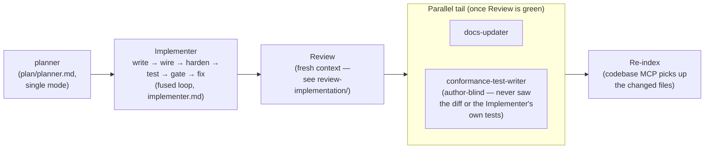

# Implementation Workflow

Automated pipeline that takes a task from specification to verified, documented,
re-indexed code. Four roles, not eighteen steps.

## Pipeline

1. **planner** — `plan/planner.md` in single mode: analyzes the codebase, identifies affected files, produces a numbered plan.
2. **Implementer** — the fused generative loop in ONE context: writes the code, wires
   every layer, hardens error paths, writes unit + integration tests, runs them, runs the
   deterministic quality gate (`scripts/quality-gate.sh`), and fixes every failure and
   finding — looping until tests AND the gate are green. `bash .claude/scripts/routing.sh
   implementation` must print `claude`, which dispatches **`implementer.md`** (agent
   `impl-implementer`, `model: inherit`). The context reading a failure is the one that wrote
   the code. `implementer.md` is the canonical envelope.
   **UI Implementer** (`coder-ui.md`, agent `impl-coder-ui`, Opus) takes design-heavy web UI
   when `routing.sh ui` names it: same fused loop with the frontend's build/test commands,
   the frontend-design skill, and a required browser check against the named design
   reference.
3. **Review (fresh context)** — by default the lean gate (`/review-implementation --lean`): a Claude pass ‖ one
   read-only omp pass per engine that `routing.sh engines review` returns (`omp-engine.sh review`), merged by
   the synthesizer's 2-vote consensus (an omp-only finding is advisory until a verifier confirms it against
   the code; only completed, valid passes and distinct engines count; a skipped or capped engine is recorded
   with its reason and the gate says how many engines ran). A high-risk diff, or one where CodeRabbit is
   installed, runs the full review instead: Claude comprehensive reviewer ‖ the omp roster ‖ CodeRabbit,
   each blind to the others, folded by the Claude **synthesizer** into one dedup'd, provenance-labelled
   report + ordered fix plan (the `/review-implementation` machinery). Neither ever sees the Implementer's
   transcript.
4. **parallel tail** — once Review is green: **docs-updater** updates docs from the
   landed code, ‖ **conformance-test-writer** runs the author-blind, plan-derived
   conformance gate (the anti-reward-hacking check).
5. **re-index** — fold the new/changed files back into the codebase MCP so semantic
   search reflects the merged code (pipeline tail + pre-push hook backstop).

## Which engine runs the fused Implementer

The routed Implementer (`routing.sh implementation`) writes all product code; the host
session never does. Two cases go elsewhere: design-heavy UI (`{{FRONTEND_DIR}}`, landing
pages, visual components) goes to the agent `routing.sh ui` names, a Claude Opus Implementer
(`orchestrator.md` → UI implementation routing; `coder-ui.md`); integrating two
already-reviewed parallel waves goes to the engine `routing.sh integration` names, followed
by the gate, tests and a scoped Claude ‖ omp review (`orchestrator.md` → Role 1;
`loop-procedures.md` → "Shared seams"). The fused write→wire→harden→test→gate→fix loop runs
in **Claude** via `implementer.md`, the only writer (the omp engines are
read-only). The
former per-concern agents (`coder.md`, `wiring.md`, `error-handling.md`,
`test-writer.md`, `test-runner.md`, `verifier.md`, `code-simplifier.md`) were fused
into that single loop and **deleted** — do not re-create them.

## Usage

**Entry point:** `/implement` slash command, or read `orchestrator.md` directly.

The orchestrator runs in the main Claude session and dispatches each role as a
subagent via the Agent tool. Specialists cannot spawn other subagents. Large work is
split at slice boundaries (a fresh Implementer per slice/wave), never mid-loop — the
handoff is `progress.md` + the plan's `<task>` XML, never a transcript.

## Engines

Roles come from `.claude/routing.json` through `.claude/scripts/routing.sh` (`routing.sh engines <role>` for
the omp roster). By default Role 1 runs in Claude (`implementer.md`); no other engine writes product code.
The omp engines (`omp:codex`, `omp:opencode`; see `.claude/skills/second-engine/SKILL.md`) join the Review
gate and the Step 4.5 advisor gate as read-only peers whose output is untrusted analysis text. The
planner, Review synthesizer, the parallel tail (docs-updater ‖ conformance-test-writer), and re-index are
Claude subagents; the docs-updater runs on Claude Haiku 5.5 and writes the docs itself, and the
conformance-test-writer stays on Claude (its blindness depends on a fresh context). Only the routed
Implementer writes product code.
