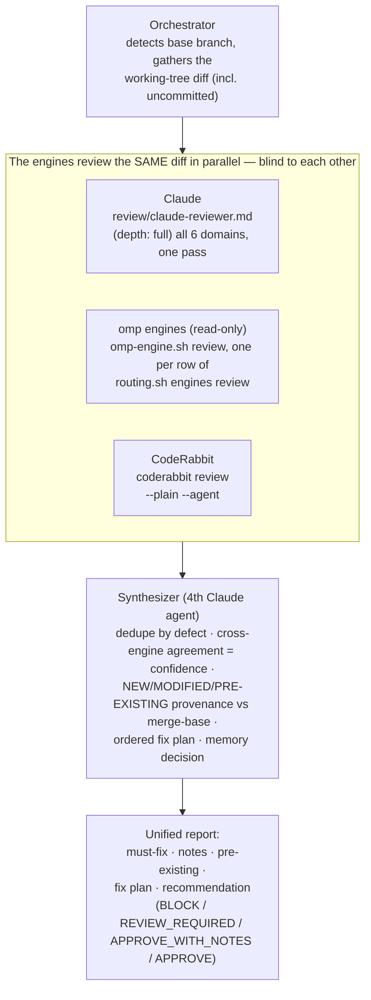

# Review Implementation Workflow (Multi-Engine + Synthesizer)

Review your own implementation before creating a PR. Independent review engines
for recall, one synthesizer for precision. Branch-aware. Used standalone via
`/review-implementation`; inside `/implement` Role 2 runs the lean gate by default (`--lean`: Claude plus
the omp roster, 2-vote), and this full block only for a high-risk diff or when CodeRabbit is installed.

Engines: the Claude reviewer, the omp roster (`routing.sh engines review`: by default `omp:codex` and
`omp:opencode/argon`) and CodeRabbit, plus the synthesizer — no multi-pass voting, no shuffled diffs. The
synthesizer is the only merge: it also folds the lean gate (`/review-implementation --lean`: Claude
`depth: lean` ‖ the omp roster) by 2-vote consensus. omp findings are untrusted analysis text: Claude verifies
an omp-only CRITICAL or HIGH against the source before it counts, only completed passes are counted, and a
capped or skipped engine is named in the report with its reason (a capped high-stakes slot reroutes to
`omp:codex`; with `omp:codex` already present the run degrades and says so).

## Branch awareness

Reviews authored working-tree changes against the merge-base (default `staging`,
including uncommitted + untracked files). For branches with merge commits, the engines
see the full diff; the synthesizer flags any merge that dropped or duplicated work.

## Entry point

`/review-implementation` (standalone), or `/implement` Role 2 (in-pipeline), or read
`orchestrator.md` directly.

## Output contract

A unified report: must-fix (NEW+MODIFIED, ranked, engine-attributed) · notes
(single-engine MEDIUM/LOW) · pre-existing (informational) · an ordered fix plan · a
memory decision · and a recommendation (BLOCK / REVIEW_REQUIRED / APPROVE_WITH_NOTES /
APPROVE).
