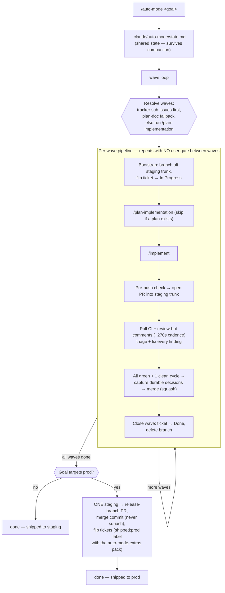
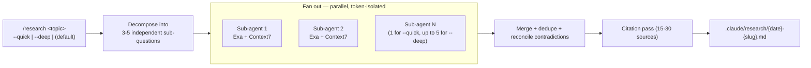

# Commands

25 slash commands, each a thin dispatcher into the agent suite under `agents/`. Grouped
here by workflow — see `agents/README.md` for the full agent-suite index each command
drives.

## Plan → build → ship

| Command | Dispatches | What it does |
| --- | --- | --- |
| `/plan-implementation` | `agents/plan/orchestrator.md` | Explore, research, multi-engine architect + judge, multi-engine plan + judge — see `agents/plan/README.md` |
| `/implement` | `agents/implementation/orchestrator.md` | Plan → routed Implementer (`routing.sh implementation`, Claude by default) → lean multi-engine review (Claude ‖ omp roster) → docs + conformance tail → re-index — see `agents/implementation/README.md` |
| `/review-implementation` | `agents/review-implementation/orchestrator.md` | Standalone multi-engine review (Claude ‖ the omp roster ‖ CodeRabbit) + synthesizer on the current branch; `--lean` runs the lean version (Claude ‖ the omp roster, 2-vote) of the review gate on the current diff |
| `/respond-to-review` | `agents/respond-to-review.md` | Classify PR review comments, verify claims, draft responses, apply fixes; AI review bots (CodeRabbit, Bugbot) get a mode that fixes, pushes and resolves, with an UNCERTAIN state |
| `/run-ci` | `scripts/run-ci.sh` + `agents/local-ci.md` | Local CI pipeline run by script (format, lint, typecheck, build, test) with a JSON result; the agent only diagnoses a failure |

## Autonomous / unattended

| Command | Dispatches | What it does |
| --- | --- | --- |
| `/auto-mode [goal]` | `skills/auto-mode/SKILL.md` | Declare the goal (written to `.claude/auto-mode/state.md`) and drive it to merged completion, wave by wave, with no user gate in between — see the diagram below |

## Explore, research, brainstorm

| Command | Dispatches | What it does |
| --- | --- | --- |
| `/explore` | `agents/plan/explorer.md` | Deep read-only codebase exploration — map code relevant to a task |
| `/research` | `agents/research/agent.md` (fan-out) | Exa multi-agent fan-out on any topic — see the diagram below |
| `/brainstorm` | `agents/brainstorm.md` | Turn a vague idea into a requirements doc, with optional browser mockups |
| `/bootstrap-project` | `agents/bootstrap/orchestrator.md` | Onboard this harness onto a new project — see `agents/bootstrap/README.md` |

## Debug

| Command | Dispatches | What it does |
| --- | --- | --- |
| `/deep-debug` | `agents/debug/{investigator,queue}.md` + `agents/debug/adversary.md` | Claude + omp investigation (`routing.sh engines debug`) + mandatory adversarial verification — see `agents/debug/README.md` |

## Codebase-wide audits

| Command | Dispatches | What it does |
| --- | --- | --- |
| `/codebase-audit` | `agents/codebase/orchestrator.md` | Tier 1 quick health check (default) or `deep` for all tier 2 audits |
| `/security-audit` | `agents/codebase/security-audit/orchestrator.md` | Cartographer → deep agents → evidence-demanding synthesizer, ASVS 5.0 L2 |
| `/error-audit` | `agents/codebase/error-audit/orchestrator.md` | One scanner per scope on Claude and the omp roster (backend, frontend, queue) |
| `/api-audit` | `agents/codebase/api-audit/orchestrator.md` | Endpoint-inventory script, then auth, validation and docs-sync passes on Claude + omp |
| `/docs-audit` | `agents/codebase/docs-audit/orchestrator.md` | Stale-reference script, then docs-vs-code passes on Claude + omp |
| `/tech-debt-audit` | `agents/codebase/tech-debt-audit/orchestrator.md` | Scan and dep-audit scripts (complexity, TODOs, library currency) + a pattern pass on Claude + omp |

## Cross-model

| Command | Dispatches | What it does |
| --- | --- | --- |
| `/second-opinion [--advisor]` | `scripts/omp-engine.sh ask` (`omp:codex`, read-only) | Put a question or task to the other engine; `--advisor` asks for an adversarial critique with ranked risks and a verdict |

## Meta

| Command | Dispatches | What it does |
| --- | --- | --- |
| `/improve-prompt` | (inline — `prompts/prompt-engineering-*.md`) | Optimize a prompt or agent file against documented best practices |

---

## `/auto-mode` — the unattended wave loop

The most complex command in the suite: it drives `/plan-implementation` and
`/implement` in a loop against a declared goal, with **no user gate between waves**,
until the whole goal is merged (and promoted to your release branch, if that's what the
goal asked for).

Escalates to the user only for genuine human-required blockers (credentials, material
scope trade-offs, external approvals, a wave red 3+ cycles with no path forward) — never
just to ask "does this look right?" between waves. See `skills/auto-mode/SKILL.md` and
its `references/loop-procedures.md` for the full state-file template and escalation ladder.

## `/research` — Exa multi-agent fan-out

